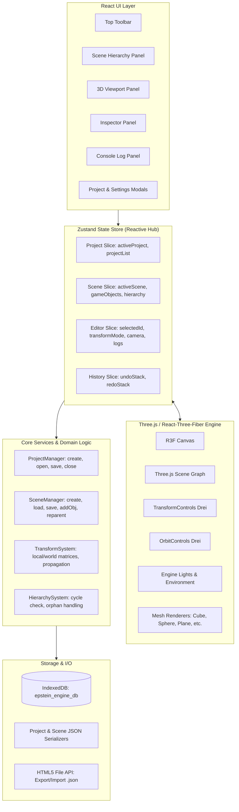
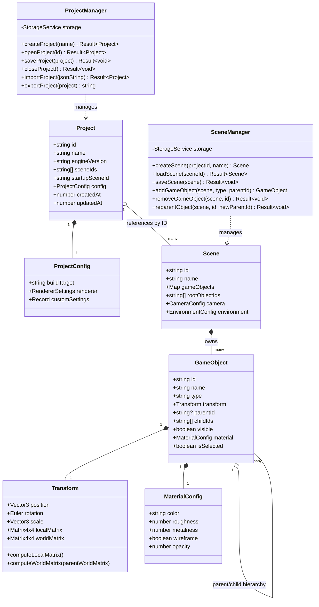
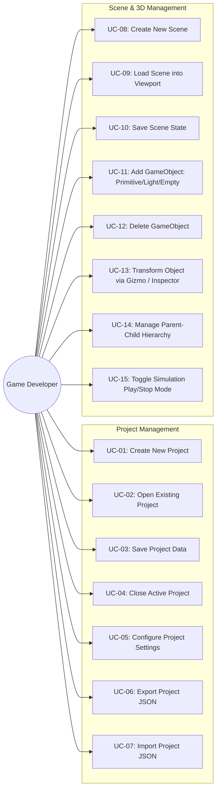
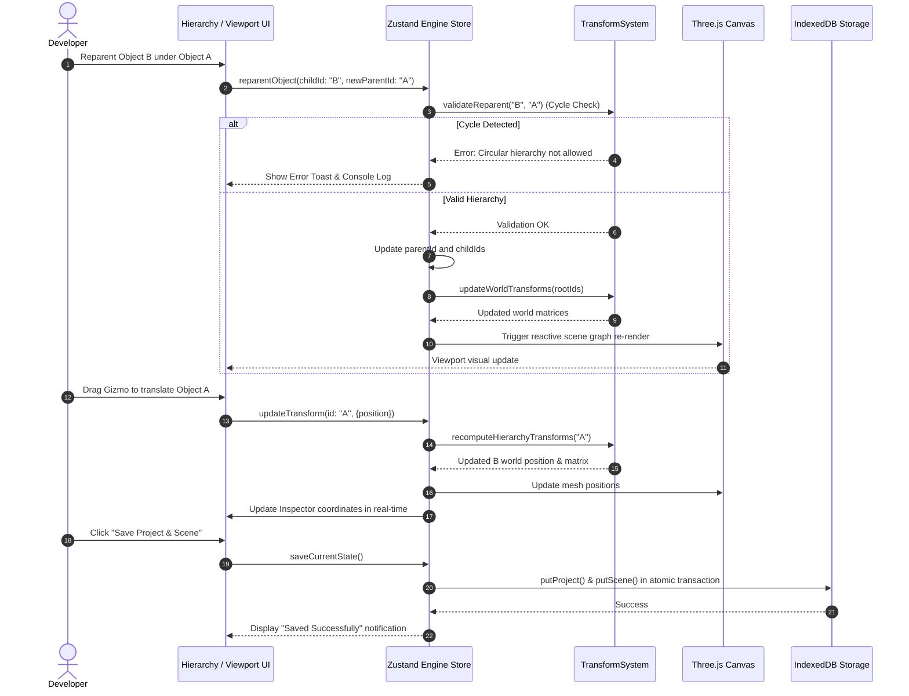

# EPSTEIN ENGINE (Web Edition) — System Diagrams & Architecture v3.0

## 1. High-Level Web Architecture Diagram

---

## 2. Updated Class Diagram (Web & Domain Model)

---

## 3. Updated Use Case Diagram

---

## 4. Updated Sequence Diagram: Hierarchy & Transform Interaction

---

## 5. Requirement-to-Module-to-Test Traceability Matrix

| Requirement ID | Description | Primary Module / Component | Verification Test ID |
|---|---|---|---|
| **FR-01** | Create Project | `ProjectManager`, `useProjectStore` | `TEST-PROJ-01` |
| **FR-02** | Open Project | `ProjectManager`, `ProjectModal` | `TEST-PROJ-02` |
| **FR-03** | Save Project | `StorageService`, `useProjectStore` | `TEST-PROJ-03` |
| **FR-04** | Close Project | `ProjectManager`, `useProjectStore` | `TEST-PROJ-04` |
| **FR-05** | Configure Settings | `SettingsModal`, `ProjectConfig` | `TEST-PROJ-05` |
| **FR-06** | Create Scene | `SceneManager`, `useSceneStore` | `TEST-SCENE-01` |
| **FR-07** | Load Scene | `SceneManager`, `Viewport3D` | `TEST-SCENE-02` |
| **FR-08** | Save Scene | `SceneManager`, `StorageService` | `TEST-SCENE-03` |
| **FR-09** | Add / Remove GameObjects | `SceneManager`, `SceneHierarchy` | `TEST-SCENE-04` |
| **FR-10** | Manage Transforms | `TransformSystem`, `Inspector`, `Gizmo` | `TEST-SCENE-05` |
| **FR-11** | Parent-Child Hierarchy | `HierarchySystem`, `SceneHierarchy` | `TEST-SCENE-06` |
| **FR-12** | Simulation & Behaviors | `Viewport3D`, `Inspector` | `TEST-SCENE-07` |
| **FR-13** | Real-Time Viewport Profiler | `Viewport3D (MetricsCollector)` | `TEST-INT-02` |
| **EXT-01** | JSON Export / Import | `StorageService`, `Toolbar` | `TEST-INT-01` |
| **INT-01** | Full End-to-End Cycle | `EpsteinEngine Integrated Workflow` | `TEST-INT-02` |
