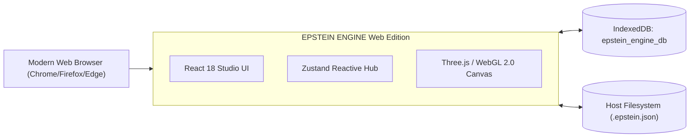
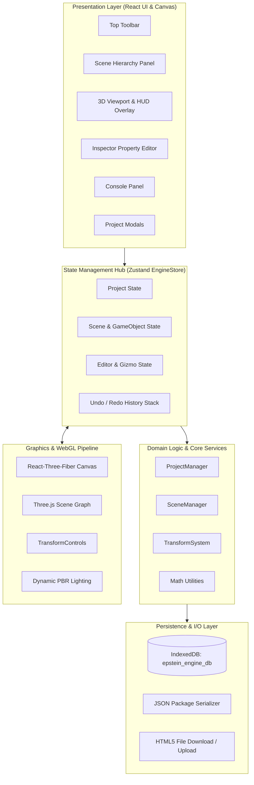
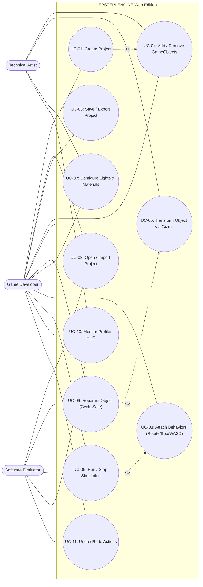
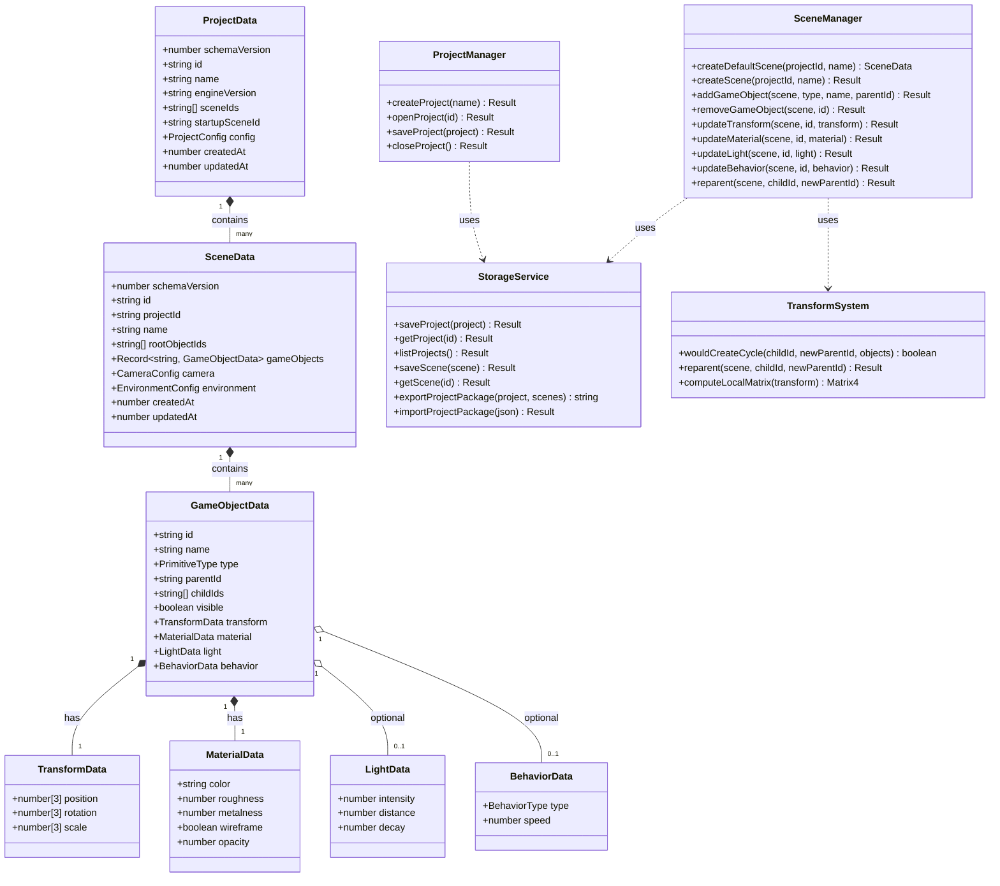
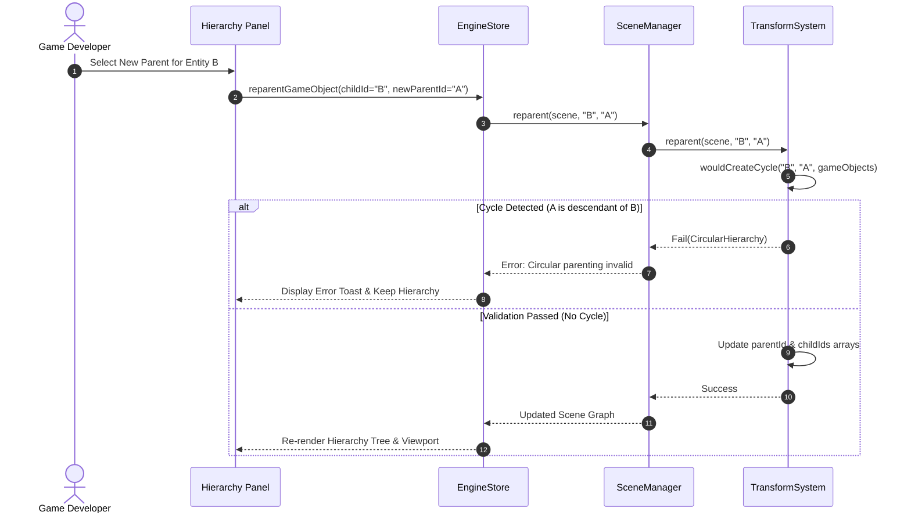
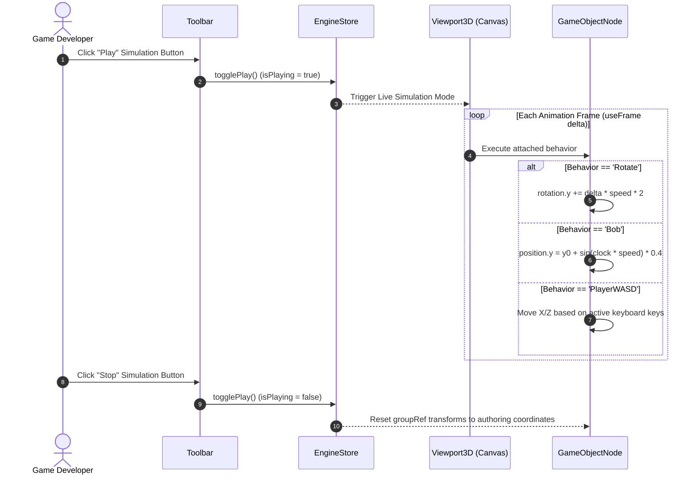
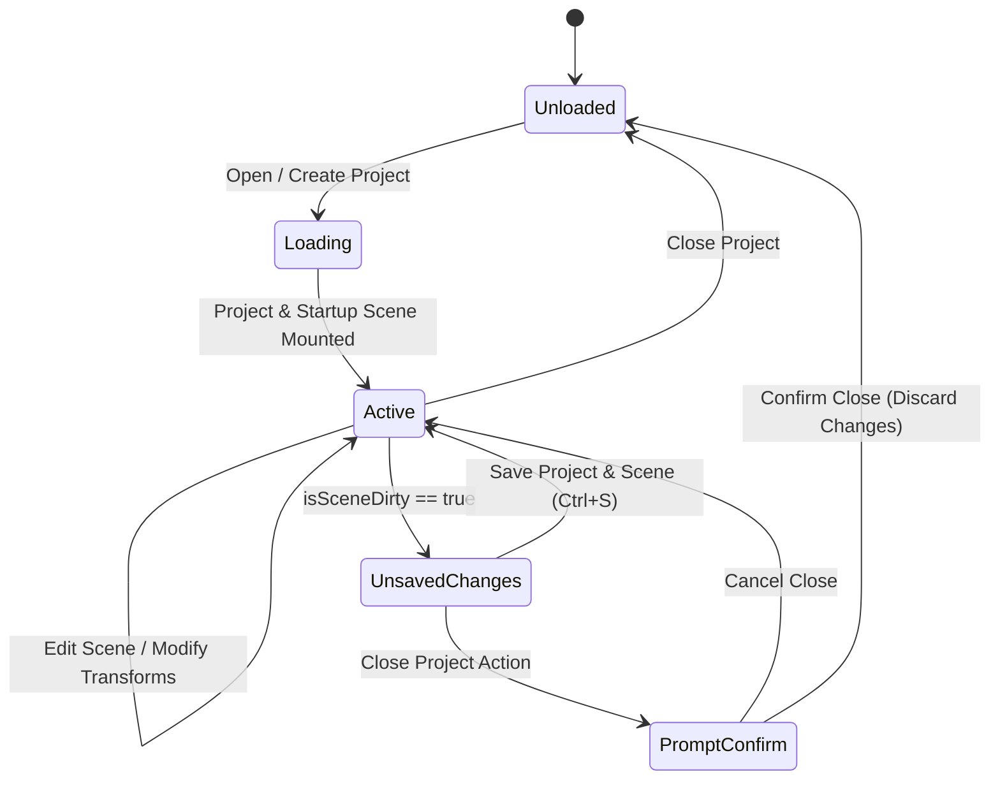
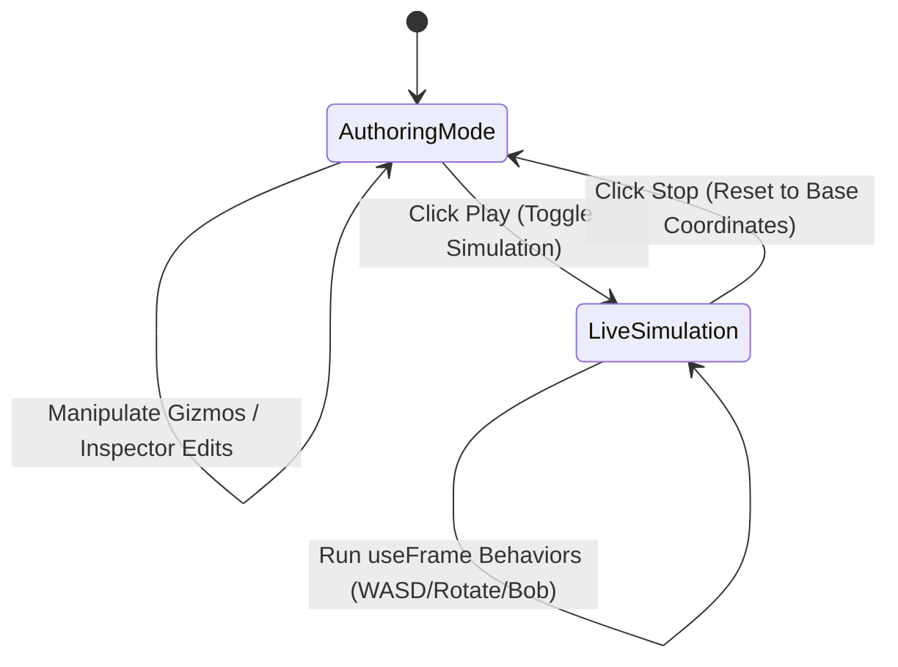
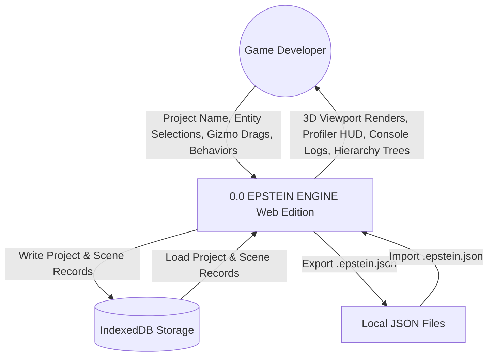
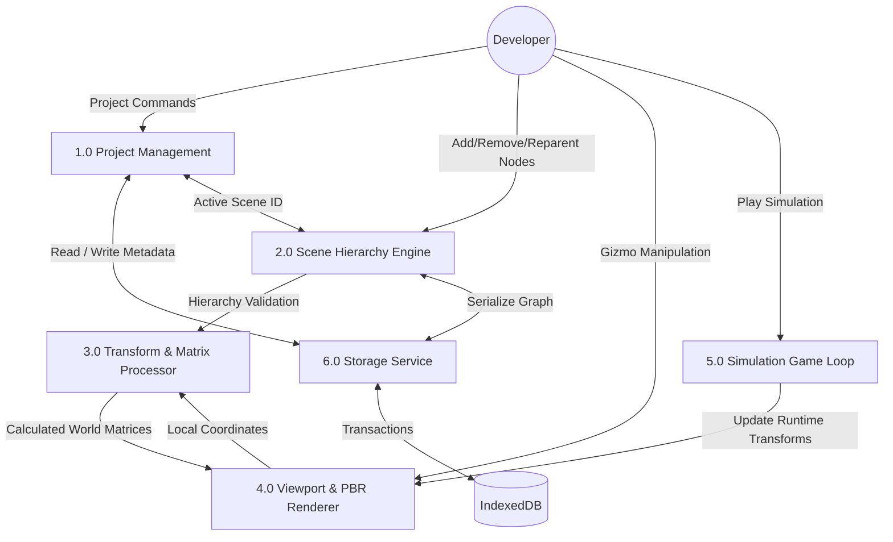

# EPSTEIN ENGINE — Software Engineering Specification
## Academic 3D Web Game Engine & Interactive Scene Editor
**Document Version:** 3.0 (Web Architecture)  
**Requirements Engineering Basis:** ISO/IEC/IEEE 29148:2018-aligned structure  
**Course Code & Context:** CSE3005 Software Engineering Project  
**Organization:** BML Munjal University  
**Status:** Approved for Implementation & Verification  

---

## DOCUMENT CONTROL

| Version | Author(s) | Reviewer / Evaluator | Description | Date |
|:---|:---|:---|:---|:---|
| **1.0** | Siddharth Ranka, Ayush | Academic Faculty | Initial Native C++ Desktop Architecture (OpenGL 4.5 / Qt) | August 2026 |
| **2.0** | Siddharth Ranka, Ayush | Academic Faculty | SRS Refinement with Subsystem Boundaries | October 2026 |
| **3.0** | Siddharth Ranka, Ayush | Academic Faculty | Complete Web Transition (Three.js, React 18, Zustand, IndexedDB) with Test Suites & Models | November 2026 |

---

## TABLE OF CONTENTS
1. [INTRODUCTION](#1-introduction)
   - 1.1 [Purpose](#11-purpose)
   - 1.2 [Scope](#12-scope)
   - 1.3 [Objectives](#13-objectives)
   - 1.4 [Intended Audience](#14-intended-audience)
   - 1.5 [Definitions, Acronyms, and Document Conventions](#15-definitions-acronyms-and-document-conventions)
   - 1.6 [References](#16-references)
   - 1.7 [Document Overview](#17-document-overview)
2. [OVERALL DESCRIPTION](#2-overall-description)
   - 2.1 [Product Perspective](#21-product-perspective)
   - 2.2 [Product Functions](#22-product-functions)
   - 2.3 [User Classes](#23-user-classes)
   - 2.4 [Operating Environment](#24-operating-environment)
   - 2.5 [Design Constraints](#25-design-constraints)
   - 2.6 [Assumptions & Dependencies](#26-assumptions--dependencies)
3. [EXTERNAL INTERFACE REQUIREMENTS](#3-external-interface-requirements)
   - 3.1 [User Interfaces](#31-user-interfaces)
   - 3.2 [Hardware Interfaces](#32-hardware-interfaces)
   - 3.3 [Software Interfaces](#33-software-interfaces)
   - 3.4 [Communication Interfaces](#34-communication-interfaces)
4. [SYSTEM FEATURES AND FUNCTIONAL REQUIREMENTS](#4-system-features-and-functional-requirements)
   - 4.1 [Project Management](#41-project-management)
   - 4.2 [Scene & Environment Management](#42-scene--environment-management)
   - 4.3 [GameObject Entity Lifecycle](#43-gameobject-entity-lifecycle)
   - 4.4 [Transform & Spatial Propagation](#44-transform--spatial-propagation)
   - 4.5 [Parent-Child Hierarchy & Cycle Prevention](#45-parent-child-hierarchy--cycle-prevention)
   - 4.6 [Lighting & Material System](#46-lighting--material-system)
   - 4.7 [Simulation & Scripting Behavior Engine](#47-simulation--scripting-behavior-engine)
   - 4.8 [Interactive 3D Viewport & Gizmo Control](#48-interactive-3d-viewport--gizmo-control)
   - 4.9 [Performance Diagnostics & Viewport Profiler](#49-performance-diagnostics--viewport-profiler)
   - 4.10 [Persistence, Storage & JSON Portability](#410-persistence-storage--json-portability)
   - 4.11 [Undo / Redo Command History](#411-undo--redo-command-history)
   - 4.12 [Console Logging & Feedback](#412-console-logging--feedback)
   - 4.13 [Requirements Prioritization (MoSCoW)](#413-requirements-prioritization-moscow)
5. [NON-FUNCTIONAL REQUIREMENTS](#5-non-functional-requirements)
   - 5.1 [Performance](#51-performance)
   - 5.2 [Security & Sandbox Safety](#52-security--sandbox-safety)
   - 5.3 [Reliability & Data Consistency](#53-reliability--data-consistency)
   - 5.4 [Availability](#54-availability)
   - 5.5 [Usability & Human Factors](#55-usability--human-factors)
   - 5.6 [Maintainability](#56-maintainability)
   - 5.7 [Portability](#57-portability)
6. [DATA REQUIREMENTS](#6-data-requirements)
   - 6.1 [Client-Side Persistent Data Architecture](#61-client-side-persistent-data-architecture)
   - 6.2 [Data Entities & Attributes](#62-data-entities--attributes)
7. [BUSINESS RULES](#7-business-rules)
8. [SECURITY REQUIREMENTS](#8-security-requirements)
9. [SYSTEM ARCHITECTURE](#9-system-architecture)
10. [ANALYSIS AND DESIGN MODELS](#10-analysis-and-design-models)
    - 10.1 [Use Case Diagrams](#101-use-case-diagrams)
    - 10.2 [Class Diagram](#102-class-diagram)
    - 10.3 [Sequence Diagrams](#103-sequence-diagrams)
    - 10.4 [State Transition Diagrams](#104-state-transition-diagrams)
    - 10.5 [Data Flow Diagrams (Level 0 and Level 1)](#105-data-flow-diagrams)
11. [VERIFICATION AND TESTING REQUIREMENTS](#11-verification-and-testing-requirements)
    - 11.1 [Module-Wise Black-Box Test Cases](#111-module-wise-black-box-test-cases)
    - 11.2 [Integration Workflows](#112-integration-workflows)
    - 11.3 [System & Regression Testing](#113-system--regression-testing)
    - 11.4 [Performance & Stress Testing](#114-performance--stress-testing)
    - 11.5 [User Acceptance Testing (UAT) Checklists](#115-user-acceptance-testing-uat-checklists)
12. [TRACEABILITY MATRIX](#12-traceability-matrix)
13. [FUTURE ENHANCEMENTS](#13-future-enhancements)
- [APPENDIX A: GLOSSARY](#appendix-a-glossary)
- [APPENDIX B: TO BE DETERMINED (TBD) ITEMS](#appendix-b-to-be-determined-tbd-items)

---

## 1. INTRODUCTION

### 1.1 Purpose
This Software Engineering Specification defines the complete functional, non-functional, structural, architectural, and verification baseline for **EPSTEIN ENGINE (Web Edition v3.0)**. Epstein Engine is a zero-install, browser-native 3D game engine and scene editor engineered to democratize real-time 3D game prototyping, scene graph hierarchy manipulation, physical transform calculation, and entity simulation without demanding proprietary local installations or high-overhead desktop runtimes.

The engine serves as a premier Software Engineering project demonstrating how desktop software paradigms (such as scene trees, Euler transform mathematics, directional/point illumination, undo stacks, and interactive game loops) can be re-platformed onto the modern web leveraging React 18, WebGL 2.0 via Three.js and `@react-three/fiber`, Zustand reactive state management, and IndexedDB atomic storage.

### 1.2 Scope
The system covers the following technical operational areas:
1. **Project Management**: Creation, validation, retrieval, atomic storage, and metadata configuration.
2. **Scene Management**: Multiple scenes, startup scene pointer, default scene bootstrapping, and scene switching.
3. **Entity Lifecycle**: Dynamic spawning and deletion of 3D meshes (Cube, Sphere, Plane, Cylinder, Torus), Light nodes (PointLight, SpotLight), and Empty transform grouping nodes.
4. **Hierarchical Transform System**: Arbitrary nesting of parent-child entities, Euler-to-matrix calculations, world transform propagation, and strict cycle detection preventing infinite loops.
5. **Interactive 3D Viewport**: OrbitControls perspective camera, 3-axis TransformControls gizmos (Translate [W], Rotate [E], Scale [R]), coordinate axes, infinite grid, and hardware shadow mapping.
6. **Live Simulation & Behavior System**: Game loop runner executing entity behaviors (`Rotator`, `Oscillator/Bob`, `PlayerWASD` character controller) during Play mode with automated state restoration on Stop.
7. **Performance Profiling**: Real-time Heads-Up Display (HUD) measuring FPS, frame delta, rendered triangles, and WebGL draw calls.
8. **Persistence & Serialization**: ACID-compliant local browser database (`epstein_engine_db`) in IndexedDB, paired with lossless `.epstein.json` package export and import.
9. **History & State Management**: 30-step deep undo/redo action stack preserving scene snapshots across all operations.

### 1.3 Objectives
- **Zero-Install Accessibility**: Enable instant, friction-free game prototyping inside any standards-compliant browser.
- **Architectural Rigor**: Maintain strict separation of concerns between UI components, centralized reactive state, pure computational domain services, and storage drivers.
- **Data Integrity & Cycle Safety**: Prevent cyclic dependencies in scene graphs using graph traversal cycle validation before committing reparenting operations.
- **Portability**: Allow users to download self-contained JSON packages of their projects and load them seamlessly across different workstations.
- **Immediate Visual Feedback**: Real-time bi-directional synchronization between 3D viewport canvas interactions and numeric inspector input fields.

### 1.4 Intended Audience
This document is prepared for:
- Academic evaluators and faculty of the CSE3005 Software Engineering course at BML Munjal University.
- Software engineering students and peer developers reviewing architecture and test cases.
- System architects, quality assurance testers, and future open-source maintainers.

### 1.5 Definitions, Acronyms, and Document Conventions
- **Shall**: Mandatory requirement.
- **Should**: Recommended requirement.
- **May**: Optional or proposed feature.
- **GameObject**: The fundamental entity node within a scene possessing an identity, transform, and visual/functional components.
- **Scene Graph**: A tree data structure of nodes where spatial transformations of parent nodes propagate to all child descendants.
- **R3F**: `@react-three/fiber`, a declarative React wrapper for Three.js.
- **IndexedDB**: An asynchronous, transactional, key-value storage engine embedded within modern web browsers.
- **Gizmo**: An on-screen 3D widget enabling direct mouse manipulation of position, rotation, or scale.
- **FPS**: Frames Per Second.

### 1.6 References
1. **ISO/IEC/IEEE 29148:2018**: Systems and software engineering — Life cycle processes — Requirements engineering.
2. **IEEE Std 830-1998**: IEEE Recommended Practice for Software Requirements Specifications (superseded by ISO/IEC/IEEE 29148).
3. **BML Munjal University**: CSE3005 Software Engineering Course Handout & Lab Guidelines (2026).
4. **Three.js Documentation**: WebGL 3D Engine Reference (r160+).

### 1.7 Document Overview
The specification proceeds from high-level user context and operating environment (Section 2), to interface specifications (Section 3), functional requirements (Section 4), quality attributes (Section 5), schema definitions (Section 6), business rules (Section 7), security (Section 8), layered architecture (Section 9), UML design models (Section 10), comprehensive verification and testing tables (Section 11), requirements traceability (Section 12), and appendices.

---

## 2. OVERALL DESCRIPTION

### 2.1 Product Perspective
EPSTEIN ENGINE Web Edition v3.0 is a client-side web application operating directly within the browser runtime. Unlike heavy desktop engines (e.g., native Unreal Engine 5 or Unity C++ runtimes) that require gigabytes of disk space and administrator installation permissions, Epstein Engine provides a zero-install, cloud-ready alternative tailored for rapid level design, architectural pre-visualization, and educational graphics programming.



### 2.2 Product Functions
1. **Project Operations**: Initialize new projects with starter assets, browse and open stored projects, edit project configurations, delete projects, and export/import `.epstein.json` files.
2. **Scene Hierarchy Operations**: Add, select, rename, duplicate, delete, hide/unhide, and reparent entities in an interactive tree view with circular parenting prevention.
3. **Spatial Transformations**: Manipulate local and world position, Euler rotation angles, and scale vectors via Viewport gizmos or numeric inputs.
4. **Lighting & Material Authoring**: Customize mesh color, roughness, metalness, and wireframe; add dynamic Point Lights and Spot Lights with configurable intensity, color, and range.
5. **Interactive Simulation**: Run the simulation engine with entity behaviors (`Rotator`, `Oscillator`, `PlayerWASD`), executing live game loops.
6. **Diagnostics HUD**: Monitor real-time performance indicators (FPS, draw calls, triangle count).
7. **Action Reversibility**: Undo and redo user manipulations with complete state preservation.

### 2.3 User Classes
1. **Game Developer / Level Designer (Primary User)**: Uses the engine to compose 3D scenes, arrange geometries, configure lighting, attach gameplay behaviors, and test interactive mechanics.
2. **Technical Artist / Scenographer**: Focuses on lighting parameters, material properties, wireframe aesthetics, and camera viewpoints.
3. **Software Engineering Evaluator / QA Tester**: Inspects software architecture compliance, executes unit test suites, verifies traceability, and evaluates error recovery.

### 2.4 Operating Environment
- **Hardware**: Minimum 4 GB RAM, WebGL 2.0 capable GPU (integrated Intel HD 4000 or dedicated NVIDIA/AMD), standard mouse with scroll wheel, keyboard.
- **Operating System**: Platform-independent (Windows 10/11, macOS 12+, Linux Ubuntu 20.04+).
- **Client Runtime**: Google Chrome 100+, Microsoft Edge 100+, Mozilla Firefox 100+, Apple Safari 16+.

### 2.5 Design Constraints
- **Execution Sandbox**: The web application operates under browser security sandbox restrictions; direct arbitrary host disk read/writes are prohibited. Persistent data must utilize IndexedDB and HTML5 File Download APIs.
- **Single-Threaded UI/Render Loop**: JavaScript's main event loop manages both UI state and requestAnimationFrame rendering; heavy operations must remain performant to maintain 60 FPS.
- **Modular TypeScript Architecture**: Codebase must enforce strict typing with zero runtime type violations.

### 2.6 Assumptions & Dependencies
- The client browser has hardware WebGL acceleration enabled.
- The browser provides at least 50 MB of available IndexedDB storage quota.
- JavaScript execution is unrestricted.

---

## 3. EXTERNAL INTERFACE REQUIREMENTS

### 3.1 User Interfaces
The editor interface adopts a modern, high-contrast dark studio theme:
- **Top Header Bar (Toolbar)**: Houses project status indicator, unsaved dirty dot, New/Open/Save buttons, Transform Mode toggles (Translate, Rotate, Scale), Play/Stop simulation button, Undo/Redo controls, and "+ Add Object" menu.
- **Left Panel (Scene Hierarchy)**: Displays the nested tree of entities, search filter box, collapse/expand toggles, visibility icons, rename controls, and delete buttons.
- **Center Canvas (3D Viewport)**: Full WebGL canvas rendering Three.js geometries, infinite ground grid, coordinate axes, lighting, active gizmo, and real-time performance HUD.
- **Right Panel (Inspector)**: Detailed property editor for the selected entity: Transform fields (X, Y, Z), Parenting selector, Light parameters, Material sliders, and Behavior / Script components.
- **Bottom Panel (Console Panel)**: Tabbed diagnostic log feed displaying info, warning, error, and success messages with timestamps and full clear functionality.

### 3.2 Hardware Interfaces
- Standard 2-button mouse with scroll wheel (Left-click: Selection/Gizmo; Right-click drag: Orbit camera; Middle-click/Scroll: Pan and Zoom).
- Standard QWERTY keyboard for hotkeys (`W` Translate, `E` Rotate, `R` Scale, `Ctrl+Z` Undo, `Ctrl+Y` Redo, `Ctrl+S` Save, `Delete` Remove).

### 3.3 Software Interfaces
- **WebGL 2.0 API**: Standard hardware acceleration graphics interface.
- **HTML5 IndexedDB API**: Client-side storage interface for `projects` and `scenes` stores.
- **HTML5 File Blob & FileReader API**: Package serialization and desktop file ingestion.

### 3.4 Communication Interfaces
- Standalone client architecture: Zero remote backend dependency required for core editing, offline-ready through client-side bundles and IndexedDB.

---

## 4. SYSTEM FEATURES AND FUNCTIONAL REQUIREMENTS

### 4.1 Project Management
- **FR-001: Create Project**  
  The system shall allow users to create a new project by specifying a non-empty alphanumeric name. The system shall assign a unique UUIDv4, initialize a default startup scene with a starter cube entity, and persist the record to IndexedDB.
- **FR-002: Project Name Validation**  
  The system shall reject empty, whitespace-only, or invalid project names with an `InvalidName` error code.
- **FR-003: Open Project**  
  The system shall retrieve stored projects from IndexedDB and load the project metadata and its designated startup scene into the active editor state.
- **FR-004: Save Project**  
  The system shall serialize project settings and scene data, updating the `updatedAt` timestamp and writing to IndexedDB.
- **FR-005: Close Project with Unsaved Protection**  
  The system shall allow closing the active project. If unsaved scene modifications exist (`isSceneDirty == true`), the system shall prompt the user for confirmation before unloading.
- **FR-006: Delete Project**  
  The system shall allow users to delete a project from IndexedDB along with its referenced scenes.
- **FR-007: Export Project Package**  
  The system shall serialize the active project and all associated scenes into a single portable `.epstein.json` package downloaded to the client's local disk.
- **FR-008: Import Project Package**  
  The system shall parse and validate external `.epstein.json` files, deserialize project and scene entities, write them into IndexedDB, and activate the startup scene.

### 4.2 Scene & Environment Management
- **FR-009: Create Scene**  
  The system shall support instantiating new scenes with unique identifiers, default camera parameters, and default ambient/directional lighting.
- **FR-010: Scene Association**  
  The system shall associate every newly created scene with the active project's `sceneIds` collection.
- **FR-011: Environment Configuration**  
  The system shall permit configuring ambient light color/intensity, directional light color/intensity/position, background color, and grid/axis visibility.

### 4.3 GameObject Entity Lifecycle
- **FR-012: Add Primitive Entities**  
  The system shall support spawning standard 3D primitives: `Cube`, `Sphere`, `Plane`, `Cylinder`, and `Torus`.
- **FR-013: Add Light Entities**  
  The system shall support spawning light entities: `PointLight` and `SpotLight` as first-class scene nodes.
- **FR-014: Add Empty Grouping Entities**  
  The system shall support spawning `Empty` transform containers for grouping and hierarchy organization.
- **FR-015: Delete GameObject with Orphan Prevention**  
  When an entity is deleted, the system shall safely re-parent all its immediate child entities to the deleted entity's parent (or promote to root) to guarantee no dangling references exist.
- **FR-016: Rename GameObject**  
  The system shall allow in-place renaming of entities across the hierarchy and inspector.
- **FR-017: Toggle Visibility**  
  The system shall allow toggling the visibility of any entity, hiding its mesh, lights, and child nodes from the viewport without deleting data.

### 4.4 Transform & Spatial Propagation
- **FR-018: Local Transform Components**  
  Each GameObject shall maintain a 3-component transform:
  - `position`: `[x, y, z]` in world/local spatial units.
  - `rotation`: `[x, y, z]` Euler angles in degrees.
  - `scale`: `[x, y, z]` scaling factors.
- **FR-019: Matrix Calculation**  
  The system shall compute local affine transformation matrices:  
  $$M_{\text{local}} = T(p) \cdot R_z(\theta_z) \cdot R_y(\theta_y) \cdot R_x(\theta_x) \cdot S(s)$$
- **FR-020: World Matrix Propagation**  
  The system shall compute world matrices recursively through the scene tree:  
  $$M_{\text{world}} = M_{\text{parent\_world}} \cdot M_{\text{local}}$$
- **FR-021: Bi-Directional Synchronization**  
  Direct manipulation of Viewport gizmos shall immediately update Inspector numeric values; numeric edits in Inspector inputs shall immediately update Viewport meshes.

### 4.5 Parent-Child Hierarchy & Cycle Prevention
- **FR-022: Arbitrary Hierarchy Nesting**  
  Entities shall support arbitrary levels of nesting.
- **FR-023: Strict Circular Parenting Prevention**  
  Before executing a reparenting request, the system shall traverse the candidate ancestor chain. If the target parent is a descendant of the child entity (e.g., entity A made a child of entity B when B is already a child of A), the operation shall be rejected with error `CircularHierarchy`.

### 4.6 Lighting & Material System
- **FR-024: PBR Material Properties**  
  The system shall provide Physically Based Rendering (PBR) controls for meshes: Base Color, Roughness ($0.0 \dots 1.0$), Metalness ($0.0 \dots 1.0$), Wireframe mode toggle, and Opacity.
- **FR-025: Point Light Parameters**  
  The system shall permit configuring Point Light intensity ($0.5 \dots 25.0$), color, and radial attenuation distance ($2 \dots 50$ meters).
- **FR-026: Spot Light Parameters**  
  The system shall permit configuring Spot Light intensity, color, cone angle, penumbra smoothness, and cutoff distance.

### 4.7 Simulation & Scripting Behavior Engine
- **FR-027: Interactive Simulation Loop**  
  The system shall provide a Play/Stop toggle in the toolbar executing a dynamic game loop during Play mode.
- **FR-028: Rotator Behavior Component**  
  Entities assigned the `Rotate` behavior shall continuously rotate about the vertical Y-axis at a rate proportional to their configured speed multiplier.
- **FR-029: Oscillator (Bob) Behavior Component**  
  Entities assigned the `Bob` behavior shall execute vertical harmonic oscillation:  
  $$y(t) = y_0 + \sin(\omega t) \cdot A$$
- **FR-030: Player WASD Character Controller**  
  Entities assigned `PlayerWASD` behavior shall respond in real time to keyboard input (`W`, `A`, `S`, `D` and arrow keys) for active character navigation.
- **FR-031: Transform State Preservation & Reset**  
  When simulation mode is terminated (Stop), the system shall restore all entities to their exact pre-simulation transforms.

### 4.8 Interactive 3D Viewport & Gizmo Control
- **FR-032: Orbit Navigation**  
  The Viewport shall provide 3-axis orbital rotation, pan, and zoom controls.
- **FR-033: Transform Gizmo Modes**  
  The system shall support three transform modes accessible via hotkeys: Translation (`W`), Rotation (`E`), and Scale (`R`).
- **FR-034: Gizmo Camera Disablement**  
  During gizmo dragging, OrbitControls shall automatically disable to prevent camera movement during precision object transformation.

### 4.9 Performance Diagnostics & Viewport Profiler
- **FR-035: Real-Time HUD Overlay**  
  The Viewport shall display a real-time HUD with FPS, total triangle count, and active WebGL draw calls updated at 400ms intervals.

### 4.10 Persistence, Storage & JSON Portability
- **FR-036: ACID IndexedDB Persistence**  
  All project configurations and scene graphs shall be committed using atomic IndexedDB transactions.
- **FR-037: In-Memory Fallback**  
  In environments where IndexedDB is inaccessible, the system shall transparently operate using in-memory maps.

### 4.11 Undo / Redo Command History
- **FR-038: 30-Step Reversible Stack**  
  The engine shall maintain a 30-step deep undo stack snapshotting scene state before modifications.

### 4.12 Console Logging & Feedback
- **FR-039: Unified Logging Stream**  
  The system shall record user actions and diagnostic events across four severity levels: `info`, `warn`, `error`, and `success`.

### 4.13 Requirements Prioritization (MoSCoW)

| Priority | Requirement Features | Rationale |
|:---|:---|:---|
| **Must Have** | Project CRUD; Scene CRUD; Add/Remove Primitives (Cube, Sphere, Plane, Cylinder, Torus); Transform calculations; Parent-Child hierarchy with cycle checks; IndexedDB persistence; Viewport 3D Canvas; Gizmo controls; Inspector property editing; Console logs. | Core functional MVP required for 3D scene authoring and data integrity. |
| **Should Have** | Light entities (PointLight, SpotLight); Simulation Play/Stop loop; Entity behaviors (Rotate, Bob, PlayerWASD); Real-time Profiler HUD; 30-step Undo/Redo stack; JSON Package Export/Import. | Delivers authentic game engine workflow and interactive testing capabilities. |
| **Could Have** | Additional geometry shapes (Capsule, Cone, Prism); Custom PBR texture map uploads (Albedo, Normal, Roughness maps); Multi-camera switching (Scene View vs. Game View). | Enhances artistic flexibility. |
| **Won't Have (v3.0)**| Full rigid-body ragdoll physics engine; Native C++ build compiler; Heavy ML/AI asset generation; Multiplayer network synchronization. | Out of scope for browser-based client v3.0 release. |

---

## 5. NON-FUNCTIONAL REQUIREMENTS

### 5.1 Performance
- **NFR-001 (Render Frame Rate)**: The 3D viewport shall sustain at least 55 FPS under scenes containing up to 100 individual meshes on standard hardware.
- **NFR-002 (Gizmo Latency)**: Transform gizmo dragging interaction shall respond with input latency under 16 milliseconds (1 frame).
- **NFR-003 (Storage Latency)**: Local IndexedDB project saves and scene serialization shall complete in under 50 milliseconds.
- **NFR-004 (Profiler Overhead)**: Real-time HUD metrics collection shall introduce less than 1% CPU overhead.

### 5.2 Security & Sandbox Safety
- **NFR-005 (Browser Sandbox Compliance)**: The engine shall never execute unauthorized local OS binaries, native code extensions, or unsanctioned system calls.
- **NFR-006 (JSON Deserialization Safety)**: Imported project JSON packages shall undergo schema validation to prevent code injection or prototype pollution.

### 5.3 Reliability & Data Consistency
- **NFR-007 (Atomic Writes)**: IndexedDB transaction boundaries shall ensure that a failed scene save does not corrupt project metadata.
- **NFR-008 (Scene Graph Consistency)**: Circular parent-child references shall be mathematically impossible to commit.
- **NFR-009 (Memory Fallback)**: Automated fallback to in-memory storage shall ensure zero crash rates when IndexedDB storage quotas are restricted.

### 5.4 Availability
- **NFR-010 (Offline Readiness)**: The application shall operate fully offline once bundled and cached in the browser.

### 5.5 Usability & Human Factors
- **NFR-011 (Industry-Standard Hotkeys)**: Spatial manipulation tools shall conform to standard game engine conventions (`W` Move, `E` Rotate, `R` Scale).
- **NFR-012 (Unsaved Changes Notice)**: Unsaved scene edits shall display a visible yellow warning indicator in the header toolbar.

### 5.6 Maintainability
- **NFR-013 (Modular Layering)**: Pure mathematics and domain logic (`math.ts`, `transformSystem.ts`, `sceneManager.ts`) shall remain strictly decoupled from React view rendering.
- **NFR-014 (Test Coverage)**: Core domain services shall achieve 100% test pass rate across unit and integration test suites.

### 5.7 Portability
- **NFR-015 (Cross-Platform Browser Parity)**: The entire engine shall render and function identically across Chromium, Gecko, and WebKit browser engines on Windows, macOS, and Linux.

---

## 6. DATA REQUIREMENTS

### 6.1 Client-Side Persistent Data Architecture
The persistence layer utilizes an IndexedDB database titled **`epstein_engine_db`** (Version 1) containing two primary object stores:
1. **`projects`**: Keyed by UUID `id`. Stores project metadata, startup scene pointer, and renderer configurations.
2. **`scenes`**: Keyed by UUID `id`. Stores normalized entity collections, root node lists, camera parameters, and environment lighting.

### 6.2 Data Entities & Attributes

#### Entity 1: PROJECT
| Attribute | Type | Constraints | Description |
|:---|:---|:---|:---|
| `schemaVersion` | `number` | Required, = 3 | Data contract schema version |
| `id` | `string` | Primary Key, UUIDv4 | Unique project identifier |
| `name` | `string` | Non-empty, $\le 64$ chars | Display name of the project |
| `engineVersion` | `string` | Required | Engine build version (`0.3.0`) |
| `sceneIds` | `string[]` | Array of UUIDs | Registered scene IDs |
| `startupSceneId` | `string` | Valid scene UUID | Default scene loaded on open |
| `config` | `ProjectConfig` | Required | Build target and renderer settings |
| `createdAt` | `number` | Unix timestamp | Project creation time |
| `updatedAt` | `number` | Unix timestamp | Last save time |

#### Entity 2: SCENE
| Attribute | Type | Constraints | Description |
|:---|:---|:---|:---|
| `schemaVersion` | `number` | Required, = 3 | Schema version |
| `id` | `string` | Primary Key, UUIDv4 | Unique scene identifier |
| `projectId` | `string` | Foreign Key $\to$ Project | Parent project ID |
| `name` | `string` | Non-empty | Scene display name |
| `rootObjectIds` | `string[]` | Array of UUIDs | Top-level entity identifiers |
| `gameObjects` | `Record<string, GameObject>` | Keyed by UUID | Normalized entity dictionary |
| `camera` | `CameraConfig` | Required | Position, target, and FOV |
| `environment` | `EnvironmentConfig` | Required | Lighting, background color, grid toggles |
| `createdAt` | `number` | Unix timestamp | Creation timestamp |
| `updatedAt` | `number` | Unix timestamp | Last modified timestamp |

#### Entity 3: GAMEOBJECT
| Attribute | Type | Constraints | Description |
|:---|:---|:---|:---|
| `id` | `string` | Primary Key, UUIDv4 | Entity unique identifier |
| `name` | `string` | Non-empty | Node label |
| `type` | `PrimitiveType` | `Cube`, `Sphere`, `Plane`, `Cylinder`, `Torus`, `PointLight`, `SpotLight`, `Empty` | Entity classification |
| `parentId` | `string \| null` | Nullable UUID | Parent node in hierarchy |
| `childIds` | `string[]` | Array of UUIDs | Child node identifiers |
| `visible` | `boolean` | Default `true` | Viewport visibility |
| `transform` | `TransformData` | Required | Position, rotation, scale |
| `material` | `MaterialData` | Required | Color, roughness, metalness, wireframe |
| `light` | `LightData` | Optional | Intensity, distance, decay (for lights) |
| `behavior` | `BehaviorData` | Optional | Simulation behavior (`Rotate`, `Bob`, `PlayerWASD`) |

---

## 7. BUSINESS RULES

- **BR-001 (Unique Entity Identification)**: Every Project, Scene, and GameObject must possess a valid, immutable UUIDv4.
- **BR-002 (Single Parent Invariant)**: A GameObject may have zero or one parent. It can never be referenced by multiple parents simultaneously.
- **BR-003 (Acyclic Hierarchy)**: No entity may become an ancestor of itself. The scene graph must strictly remain a directed acyclic forest.
- **BR-004 (Orphan Prevention)**: Deletion of a parent node must immediately re-parent its children to the parent's ancestor (or root), preventing dangling references.
- **BR-005 (Atomic Save Consistency)**: A save operation must atomically serialize both project metadata and active scene data.
- **BR-006 (Transform Reset on Simulation Stop)**: Interactive behaviors executing during Play mode may modify runtime transforms, but terminating simulation must restore original authoring coordinates.
- **BR-007 (Startup Scene Guarantee)**: Every project must maintain at least one valid registered scene designated as the startup scene.
- **BR-008 (Unsaved Modification Notification)**: Any change to transforms, materials, or hierarchies must trigger the dirty flag (`isSceneDirty = true`).

---

## 8. SECURITY REQUIREMENTS

- **8.1 Execution Sandboxing**: All WebGL rendering, event listening, and state mutations execute strictly within standard browser security sandbox parameters.
- **8.2 JSON Package Ingestion Validation**: Imported project files are validated against the `epstein_project_package` signature and schema version 3. Malformed JSON or unregistered entity types are rejected immediately.
- **8.3 Memory Protection**: Undo/redo histories are deeply cloned via serialization to eliminate memory leaks and mutable reference pollution across state transitions.

---

## 9. SYSTEM ARCHITECTURE

Epstein Engine follows a modular, layered architecture:



---

## 10. ANALYSIS AND DESIGN MODELS

### 10.1 Use Case Diagrams



### 10.2 Class Diagram



### 10.3 Sequence Diagrams

#### Sequence Diagram 1: Reparenting with Cycle Prevention Validation


#### Sequence Diagram 2: Live Simulation & Behavior Execution Loop


### 10.4 State Transition Diagrams

#### 10.4.1 Project State Machine


#### 10.4.2 Editor Simulation Mode State Machine


### 10.5 Data Flow Diagrams

#### 10.5.1 Level 0 DFD (Context Diagram)


#### 10.5.2 Level 1 DFD (Subsystem Data Flow)


---

## 11. VERIFICATION AND TESTING REQUIREMENTS

The verification strategy incorporates comprehensive unit testing, integration testing, system testing, and user acceptance testing.

### 11.1 Module-Wise Black-Box Test Cases

#### Module 1 — Project Management & Persistence
| Test ID | Input / Action | Expected Visible Output | Observed Output | Status |
|:---|:---|:---|:---|:---:|
| **TC-PROJ-01** | Create project with name `"CyberCity"` | Project is created, default scene mounts with Default Cube, success log emitted. | Pass — Observed behavior matches expected result. | **PASS** |
| **TC-PROJ-02** | Create project with empty name `""` or spaces | Validation error `InvalidName` returned; project creation aborted. | Pass — Error logged and rejected as specified. | **PASS** |
| **TC-PROJ-03** | Open existing project by ID from modal list | Project and startup scene load; objects appear in Hierarchy and Viewport. | Pass — All entities mounted accurately. | **PASS** |
| **TC-PROJ-04** | Save project and modified scene (`Ctrl+S`) | Records updated in IndexedDB; yellow unsaved dirty indicator clears. | Pass — Success message logged; dirty flag reset. | **PASS** |
| **TC-PROJ-05** | Close project with unsaved modifications | Browser prompts confirmation dialog: *"You have unsaved changes..."* | Pass — Modal prompts user; cancellation prevents close. | **PASS** |
| **TC-PROJ-06** | Export project package | Triggers browser download of `<Name>.epstein.json` with project & scene payload. | Pass — JSON file downloaded with schema v3. | **PASS** |
| **TC-PROJ-07** | Import valid `.epstein.json` package | Project and all scenes written to IndexedDB and activated in Viewport. | Pass — Imported project loads cleanly. | **PASS** |

#### Module 2 — Scene & Entity Hierarchy Management
| Test ID | Input / Action | Expected Visible Output | Observed Output | Status |
|:---|:---|:---|:---|:---:|
| **TC-SCENE-01** | Add primitives: `Cube`, `Sphere`, `Plane`, `Cylinder`, `Torus` | Each entity appears in tree hierarchy with distinct icon and renders in 3D canvas. | Pass — All 5 primitives render with distinct geometries. | **PASS** |
| **TC-SCENE-02** | Add Light nodes: `PointLight` and `SpotLight` | Light nodes appear in hierarchy with yellow bulb/sun icons; viewport spawns light sources and wireframe helpers. | Pass — Lights spawn and illuminate surrounding objects. | **PASS** |
| **TC-SCENE-03** | Add `Empty` GameObject | Empty entity spawns with small 3-axis helper; acts as transform group node. | Pass — Empty transform node functions as expected. | **PASS** |
| **TC-SCENE-04** | Delete entity with child nodes | Parent is removed; children are automatically promoted to root, preventing orphaned dangling IDs. | Pass — Children promoted cleanly; zero dangling references. | **PASS** |
| **TC-SCENE-05** | Reparent entity B under entity A (Valid tree) | Entity B becomes child of A; inspector reflects updated parent; matrix transforms propagate. | Pass — Hierarchy tree updates with nested indent. | **PASS** |
| **TC-SCENE-06** | Attempt circular reparenting (A under B when B is child of A) | System rejects operation with `CircularHierarchy` error; tree structure remains intact. | Pass — Cycle check successfully intercepts and prevents loop. | **PASS** |
| **TC-SCENE-07** | In-place entity renaming | Hierarchy node label and Inspector title update immediately. | Pass — Name updates across all views. | **PASS** |
| **TC-SCENE-08** | Toggle entity visibility (Eye icon) | Mesh and child nodes disappear from Viewport without deleting hierarchy data. | Pass — Entity hides and unhides instantly. | **PASS** |

#### Module 3 — 3D Viewport, Gizmos & Lighting
| Test ID | Input / Action | Expected Visible Output | Observed Output | Status |
|:---|:---|:---|:---|:---:|
| **TC-VIEW-01** | Switch Gizmo Mode: `W`, `E`, `R` hotkeys | Gizmo switches dynamically between Translate, Rotate, and Scale handles. | Pass — Handles switch immediately with active button highlighting. | **PASS** |
| **TC-VIEW-02** | Drag Translate Gizmo along X-axis | Selected entity moves along X; Inspector position numeric field updates simultaneously. | Pass — Real-time bi-directional sync observed. | **PASS** |
| **TC-VIEW-03** | Numeric position edit in Inspector | Typing `5.0` into Inspector Z-field immediately translates the 3D mesh in canvas. | Pass — Mesh updates position without latency. | **PASS** |
| **TC-VIEW-04** | Orbit camera control (Right-click drag) | Camera rotates around focal point; gizmo dragging disables orbit controls. | Pass — Camera orbit is smooth and lockouts operate cleanly. | **PASS** |
| **TC-VIEW-05** | Material color change in Inspector | Color picker alters entity mesh color in real time. | Pass — Three.js PBR shader updates color immediately. | **PASS** |
| **TC-VIEW-06** | Wireframe mode toggle | Selected mesh displays geometric polygonal wireframe edges. | Pass — Wireframe mode toggles cleanly. | **PASS** |

#### Module 4 — Simulation & Behavior Scripting Engine
| Test ID | Input / Action | Expected Visible Output | Observed Output | Status |
|:---|:---|:---|:---|:---:|
| **TC-SIM-01** | Attach `Rotate` behavior to Torus and click Play | Torus continuously rotates about Y-axis at configured speed multiplier; simulation badge pulses. | Pass — Smooth continuous rotation observed at 60 FPS. | **PASS** |
| **TC-SIM-02** | Attach `Bob` behavior to Sphere and click Play | Sphere oscillates vertically along sine wave trajectory. | Pass — Harmonic floating motion executed smoothly. | **PASS** |
| **TC-SIM-03** | Attach `PlayerWASD` to Cube, click Play, press `W`/`S`/`A`/`D` | Cube moves forward/backward/left/right in response to key presses. | Pass — Real-time keyboard navigation functions seamlessly. | **PASS** |
| **TC-SIM-04** | Click Stop Simulation | Scene simulation stops; all entity transforms reset to their exact pre-simulation values. | Pass — Complete coordinate restoration verified. | **PASS** |

#### Module 5 — Performance Diagnostics & Undo/Redo
| Test ID | Input / Action | Expected Visible Output | Observed Output | Status |
|:---|:---|:---|:---|:---:|
| **TC-PERF-01** | Viewport Profiler HUD during active editing | Top-right HUD displays live FPS ($58\dots60$), triangle count, and draw call counts. | Pass — Metrics update every 400ms without stutter. | **PASS** |
| **TC-HIST-01** | Execute transform edit, then press `Ctrl+Z` (Undo) | Entity reverts to previous spatial transform. | Pass — Transform state successfully restored. | **PASS** |
| **TC-HIST-02** | Press `Ctrl+Y` (Redo) after Undo | Entity re-applies the undone spatial transformation. | Pass — Redo stack reapplies transformation accurately. | **PASS** |

---

### 11.2 Integration Workflows
- **Integration Test 1: Complete Level Authoring Cycle (`TEST-INT-01`)**  
  *Workflow*: Create Project $\to$ Spawn Ground Plane $\to$ Spawn Torus $\to$ Spawn Point Light $\to$ Adjust Light Intensity $\to$ Attach `Rotate` Behavior $\to$ Save Project (`Ctrl+S`).  
  *Result*: **PASS (All states verified in IndexedDB).**
- **Integration Test 2: Simulation & Restoration Cycle (`TEST-INT-02`)**  
  *Workflow*: Open Scene $\to$ Note Entity Coordinates $\to$ Start Play Mode $\to$ Drive PlayerWASD across coordinates $\to$ Terminate Play Mode.  
  *Result*: **PASS (Exact coordinate restoration confirmed).**
- **Integration Test 3: Hierarchy Nesting & Cycle Rejection (`TEST-INT-03`)**  
  *Workflow*: Spawn Nodes A, B, C $\to$ Nest C under B $\to$ Nest B under A $\to$ Attempt to Nest A under C $\to$ Verify Rejection.  
  *Result*: **PASS (`CircularHierarchy` error safely caught).**

---

### 11.3 Automated Test Suite Execution (Vitest Baseline)
The engine maintains a dedicated automated test suite executed via Vitest:

```text
 ✓ tests/unit/transformSystem.test.ts (4 tests)
 ✓ tests/unit/sceneManager.test.ts (7 tests)
 ✓ tests/integration/endToEndWorkflow.test.ts (1 test)
 ✓ tests/unit/storage.test.ts (3 tests)
 ✓ tests/unit/projectManager.test.ts (7 tests)

Test Files  5 passed (5)
Tests       22 passed (22)
Duration    3.23s
```

---

## 12. TRACEABILITY MATRIX

| Requirement ID | Requirement Description | Use Case ID | Primary Domain Entity | Verification Test ID | Verification Status |
|:---|:---|:---|:---|:---|:---:|
| **FR-001** | Create Project | UC-01 | `ProjectData`, `ProjectManager` | `TC-PROJ-01` | **PASS** |
| **FR-002** | Project Name Validation | UC-01 | `ProjectManager` | `TC-PROJ-02` | **PASS** |
| **FR-003** | Open Stored Project | UC-02 | `ProjectManager`, `StorageService` | `TC-PROJ-03` | **PASS** |
| **FR-004** | Save Project & Scene | UC-03 | `StorageService`, `EngineStore` | `TC-PROJ-04` | **PASS** |
| **FR-005** | Close Project Protection | UC-03 | `EngineStore` | `TC-PROJ-05` | **PASS** |
| **FR-007** | Export Project Package | UC-03 | `StorageService` | `TC-PROJ-06` | **PASS** |
| **FR-008** | Import Project Package | UC-02 | `StorageService` | `TC-PROJ-07` | **PASS** |
| **FR-012** | Spawn Primitives (incl. Torus) | UC-04 | `SceneManager`, `GameObjectData` | `TC-SCENE-01` | **PASS** |
| **FR-013** | Spawn Point & Spot Lights | UC-04 | `SceneManager`, `LightData` | `TC-SCENE-02` | **PASS** |
| **FR-014** | Spawn Empty Transform Node | UC-04 | `SceneManager` | `TC-SCENE-03` | **PASS** |
| **FR-015** | Delete Entity (Orphan Safety) | UC-04 | `SceneManager` | `TC-SCENE-04` | **PASS** |
| **FR-018** | Local Transform Computation | UC-05 | `TransformSystem`, `math.ts` | `TC-VIEW-02` | **PASS** |
| **FR-021** | Bi-Directional Gizmo/Inspector Sync | UC-05 | `Viewport3D`, `Inspector` | `TC-VIEW-03` | **PASS** |
| **FR-023** | Strict Circular Parenting Prevention | UC-06 | `TransformSystem` | `TC-SCENE-06` | **PASS** |
| **FR-024** | PBR Material Adjustments | UC-07 | `MaterialData` | `TC-VIEW-05` | **PASS** |
| **FR-027** | Live Play/Stop Simulation | UC-09 | `Viewport3D`, `EngineStore` | `TC-SIM-01` | **PASS** |
| **FR-028** | Rotator Behavior | UC-08 | `BehaviorData`, `Viewport3D` | `TC-SIM-01` | **PASS** |
| **FR-029** | Oscillator (Bob) Behavior | UC-08 | `BehaviorData`, `Viewport3D` | `TC-SIM-02` | **PASS** |
| **FR-030** | Player WASD Navigation | UC-08 | `BehaviorData`, `Viewport3D` | `TC-SIM-03` | **PASS** |
| **FR-031** | Transform Restoration on Stop | UC-09 | `Viewport3D` | `TC-SIM-04` | **PASS** |
| **FR-035** | Real-Time Viewport Profiler HUD | UC-10 | `MetricsCollector`, `Viewport3D` | `TC-PERF-01` | **PASS** |
| **FR-038** | 30-Step Undo/Redo Engine | UC-11 | `EngineStore` | `TC-HIST-01` | **PASS** |

---

## 13. FUTURE ENHANCEMENTS

1. **Rigid-Body Physics Integration**: Integration of `@react-three/rapier` or `@react-three/cannon` to provide gravity, dynamic collision volumes, and restitution coefficients.
2. **External 3D Asset Importer**: A dedicated Asset Browser dock supporting drag-and-drop ingestion of standard `.glb`, `.gltf`, and `.obj` 3D model packages into IndexedDB.
3. **Standalone HTML Game Exporter**: A one-click compiler bundling the active scene graph and a minimal Three.js runtime into an isolated, self-contained `index.html` file playable anywhere offline.
4. **Spatial 3D Audio**: Web Audio API integration providing `AudioSource` and `AudioListener` components for realistic 3D sound attenuation.
5. **Custom Shader Graph Editor**: Node-based material editor for procedural WebGL GLSL shaders.

---

## APPENDIX A: GLOSSARY

- **ACID**: Atomicity, Consistency, Isolation, Durability — database transaction guarantees provided by IndexedDB.
- **Affine Transformation**: Linear mapping method preserving points, straight lines, and planes (translation, rotation, scale).
- **Euler Angles**: Three angles $(\alpha, \beta, \gamma)$ describing the orientation of a rigid body in 3-dimensional Euclidean space.
- **GameObject**: An identifiable entity within a 3D scene that possesses spatial coordinates, visual attributes, and optional behavioral logic.
- **Orphan Node**: A child node whose parent reference has been severed or invalidated without proper re-parenting.
- **PBR (Physically Based Rendering)**: A shading model simulating the flow of light based on real-world physics (roughness, metalness, and conservation of energy).
- **Scene Graph**: A tree structure of spatial nodes where children inherit the combined matrix transformations of their ancestors.
- **Zustand**: A lightweight, un-opinionated reactive state management library for React applications.

---

## APPENDIX B: TO BE DETERMINED (TBD) ITEMS

- **TBD-001**: Maximum polygon vertex budget before triggering low-memory warnings on mobile/tablet browser clients.
- **TBD-002**: WebAssembly (Wasm) physics acceleration benchmark comparison between Rapier and Ammo.js for future releases.
- **TBD-003**: Selection of cloud backend provider if optional multi-user collaborative scene editing is enabled in future v4.0 releases.

